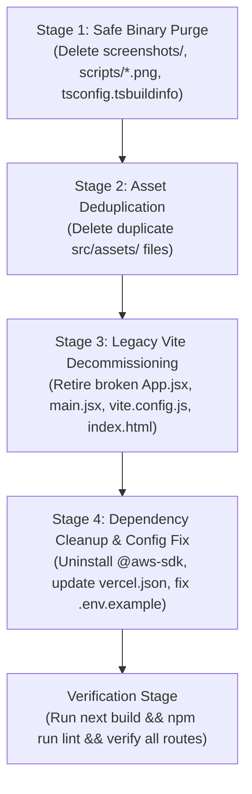

# COMPLETE WEBSITE CODEBASE CLEANUP AUDIT REPORT
**Project:** MNC LifeStyle (Ultra-Premium Furniture E-Commerce & Atelier Concierge)
**Location:** Visakhapatnam, Andhra Pradesh, India
**Role:** Senior Software Architect, Full-Stack Developer & Codebase Auditor
**Date:** November 2026
**Audit Phase:** Stage 1 – Read-Only Technical Audit (Zero source files modified, deleted, moved, or renamed)

---

## 1. Executive Summary & Architectural Overview

An exhaustive, evidence-based technical audit was conducted across the entire MNC LifeStyle codebase. The audit inspected **342 non-ignored files** across all directories, analyzed import dependency graphs, examined Next.js vs Vite runtime architectures, evaluated package dependencies, audited dead code, and evaluated asset storage.

### Key Architectural Finding: Hybrid Migration Residue
The codebase underwent a major architectural migration from a static client-side **Vite + React Router v7 SPA** to a modern **Next.js 16.4.6 App Router (Turbopack) + MongoDB (Mongoose) + Cloudinary** production stack. However, the legacy Vite setup was **never cleaned up**.

- **The Active Production Application** runs entirely on Next.js 16.4.6 (`src/app/layout.tsx`, `src/app/(store)/*`, `src/app/admin/*`, `src/app/api/*`). Running `npm run build` (`next build`) builds **100% cleanly in 4.7s** across all 25 API routes and 17 pages.
- **The Legacy Vite SPA** (`index.html`, `vite.config.js`, `src/main.jsx`, `src/App.jsx`, `src/App.css`, `src/layouts/MainLayout.jsx`) is **completely broken** (`npm run vite:build` fails because `App.jsx` imports from non-existent `./pages/*`).
- **Vercel Routing Danger (`vercel.json`):** `vercel.json` contains a legacy SPA wildcard rewrite `{"source": "/(.*)", "destination": "/index.html"}`. If deployed to Vercel without modification, this rewrite conflicts directly with Next.js dynamic App Router routes, server-side rendering, and backend API endpoints.
- **Asset Duplication:** 4 core media files in `src/assets/` (`hero-bg.png`, `hero-bg.webp`, `live-beautifully.png`, `logo.png`) are byte-for-byte SHA-256 duplicates of files in `public/`. Next.js serves static assets from `public/` directly; `src/assets/` is imported by zero source files.
- **Test Artifact Bloat:** Automated Puppeteer visual regression scripts deposited **87 screenshot files (37.35 MB) in `screenshots/`** and **61 screenshot files (20.48 MB) directly into `scripts/`**, representing **~57.8 MB of binary clutter**.

---

## 2. Repository Inventory & Directory Breakdown

| Directory / Scope | Total Files | Directory Size | Primary Purpose & Contents |
| :--- | :---: | :---: | :--- |
| **Root Directory (`/`)** | 30 | ~5.8 MB | Root configs (`package.json`, `next.config.mjs`, `tailwind.config.js`, `tsconfig.json`, `postcss.config.js`, `.oxlintrc.json`), 8 audit reports, 4 test images, `tsconfig.tsbuildinfo`, `vercel.json`, `vite.config.js`, `atlas-credentials.env` |
| **`public/`** | 8 | 2.38 MB | Static web assets (`hero-bg.webp`, `logo.png`, `favicon.svg`, `icons.svg`, `robots.txt`, `sitemap.xml`) |
| **`src/app/`** | 36 | 82 KB | Next.js App Router: Storefront routes `(store)`, Admin routes `admin`, and 25 REST API endpoints `api` |
| **`src/components/`** | 24 | 225 KB | Storefront UI components (`Header`, `Hero`, `CategoryGrid`, `Footer`, etc.) and Admin management components (`ProductForm`, `ProductListClient`, etc.) |
| **`src/views/`** | 8 | 150 KB | Full storefront views (`Home.jsx`, `Shop.jsx`, `Category.jsx`, `ProductDetails.jsx`, `About.jsx`, `Contact.jsx`, `Collections.jsx`, `NotFound.jsx`) |
| **`src/models/`** | 6 | 18 KB | Mongoose database schemas (`Product.ts`, `Category.ts`, `Collection.ts`, `Admin.ts`, `InventoryMovement.ts`, `index.ts`) |
| **`src/services/`** | 3 | 8 KB | Database service layer with static data fallback (`productService`, `categoryService`, `collectionService`) |
| **`src/data/`** | 4 | 46 KB | Centralized mock and fallback catalog data (`products.js`, `categories.js`, `collections.js`, `businessConfig.js`) |
| **`src/lib/`** | 9 | 24 KB | Authentication (`auth.ts`), MongoDB singleton (`mongodb.ts`), router bridge (`router-bridge.ts`), Cloudinary storage (`storage/`), Zod validations (`validations/`) |
| **`src/utils/`** | 2 | 5 KB | Currency formatting (`currency.js`) and WhatsApp message constructor (`whatsapp.js`) |
| **`src/context/`** | 2 | 6 KB | React context state (`CartContext.jsx`, `WishlistContext.jsx`) |
| **`src/hooks/`** | 1 | 3.5 KB | IntersectionObserver animation hook (`useScrollReveal.js`) |
| **`src/assets/`** | 7 | 2.39 MB | Legacy assets; 4 exact duplicates of `public/`, 2 Vite template SVGs, 1 unused PNG |
| **`src/scripts/`** | 12 | 114 KB | Database migrations, seeding, and backend verification scripts |
| **`scripts/` (Scripts)** | 28 | 110 KB | Standalone Puppeteer visual testing, responsive audit, and transformation checks |
| **`scripts/` (Images)** | 61 | 20.48 MB | Generated `.png` visual regression screenshots saved inside `scripts/` |
| **`screenshots/`** | 87 | 37.35 MB | Visual audit screenshots across 13 device viewports + 2 test JSON reports |
| **Excluded Build Folders** | 1,672 | ~434 MB | `.next` (430.89 MB), `dist` (3.31 MB), `node_modules` (excluded from audit table) |

---

## 3. File Classification Summary

Every non-ignored file in the repository was classified into one of the six standard audit categories:

| Classification Category | File Count | Total Size | Description & Strategic Action |
| :--- | :---: | :---: | :--- |
| **CATEGORY A – CONFIRMED UNUSED** | **6** | **0.35 MB** | Zero imports, zero references, no framework role. Safe to remove immediately. |
| **CATEGORY B – PROBABLY UNUSED** | **5** | **0.05 MB** | Orphaned UI components and uncalled barrel file. Require business confirmation before deletion. |
| **CATEGORY C – DUPLICATE / REDUNDANT** | **9** | **2.37 MB** | Files superseded by another active implementation (identical assets, superseded layouts). |
| **CATEGORY D – OUTDATED** | **161** | **61.90 MB** | Legacy Vite remnants, broken configs, historical audit logs, and 148 test screenshots. |
| **CATEGORY E – REQUIRED** | **123** | **3.12 MB** | Core Next.js routes, storefront views, components, services, models, and public assets. **Must not be modified or deleted.** |
| **CATEGORY F – UNKNOWN / NEEDS MANUAL VERIFICATION** | **38** | **0.20 MB** | Developer test scripts, Puppeteer suites, and local Atlas credential file. |
| **TOTAL INSPECTED REPOSITORY** | **342** | **68.00 MB** | **Excludes `.next`, `dist`, `node_modules`, `.git`** |

---

## 4. Category A: Confirmed Unused Files (6 Files — 0.35 MB)
These files have **zero imports**, **zero string references** in any application logic, no Next.js framework discovery role, and serve no active runtime purpose:

1. **`tsconfig.tsbuildinfo`** (344.6 KB):
   - *Reason:* TypeScript incremental compiler build cache file committed to root. Re-created automatically by `tsc`.
   - *Risk:* LOW | *Confidence:* HIGH | *Action:* Delete.
2. **`src/components/CartDrawer.jsx`** (70 Bytes):
   - *Reason:* Empty stub component containing only `export default function CartDrawer() { return null; }`. Imported by 0 files.
   - *Risk:* LOW | *Confidence:* HIGH | *Action:* Delete or retain stub.
3. **`src/components/WishlistDrawer.jsx`** (74 Bytes):
   - *Reason:* Empty stub component containing only `export default function WishlistDrawer() { return null; }`. Imported by 0 files.
   - *Risk:* LOW | *Confidence:* HIGH | *Action:* Delete or retain stub.
4. **`src/assets/react.svg`** (4.1 KB):
   - *Reason:* Default Vite starter template SVG logo. Unreferenced in code.
   - *Risk:* LOW | *Confidence:* HIGH | *Action:* Delete.
5. **`src/assets/vite.svg`** (8.7 KB):
   - *Reason:* Default Vite starter template SVG logo. Unreferenced in code.
   - *Risk:* LOW | *Confidence:* HIGH | *Action:* Delete.
6. **`src/assets/hero.png`** (13.1 KB):
   - *Reason:* Unreferenced legacy image. Next.js storefront uses `/hero-bg.webp` from `public/`.
   - *Risk:* LOW | *Confidence:* HIGH | *Action:* Delete.

---

## 5. Category B: Probably Unused Files (5 Files — 0.05 MB)
These files contain functional code but currently have **zero imports** across the codebase. They represent abandoned experiments or incomplete feature branches:

1. **`src/components/ShopTheLook.jsx`** (6.2 KB):
   - *Reason:* Interactive room lookbook component with coordinate hotspots. Present in original Vite homepage mockup, but intentionally removed from `src/views/Home.jsx` during the November Indian market redesign (`MNC_LIFESTYLE_FIX_REPORT.md`).
   - *Risk:* MEDIUM | *Confidence:* HIGH | *Action:* Retain in a `components/archive/` folder if planned for future restoration, or safely remove.
2. **`src/components/ProductQuickViewModal.jsx`** (8.8 KB):
   - *Reason:* Fully built product preview modal with swatch selectors. Never wired into `ProductCard.jsx`, `Shop.jsx`, or `Category.jsx`.
   - *Risk:* LOW | *Confidence:* HIGH | *Action:* Retain if quick-view feature is on the product roadmap; otherwise archive.
3. **`src/components/SwatchModal.jsx`** (9.8 KB):
   - *Reason:* Modal allowing customers to request complimentary fabric & wood finish samples. Unreferenced by any view.
   - *Risk:* LOW | *Confidence:* HIGH | *Action:* Retain if swatch order concierge is planned; otherwise archive.
4. **`src/components/admin/InventoryAdjustModal.tsx`** (23.2 KB):
   - *Reason:* Comprehensive 500-line inventory adjustment modal created during Phase 8. Unreferenced because `src/app/admin/inventory/page.tsx` redirects to `/admin/products`.
   - *Risk:* MEDIUM | *Confidence:* HIGH | *Action:* Retain until full inventory management dashboard UI is deployed.
5. **`src/models/index.ts`** (147 Bytes):
   - *Reason:* Barrel re-export file. All API routes and services import models directly (e.g. `@/models/Product`, `@/models/Category`).
   - *Risk:* LOW | *Confidence:* MEDIUM | *Action:* Retain as standard TypeScript convention or remove.

---

## 6. Category C: Duplicate & Redundant Files (9 Files — 2.37 MB)

### 6.1 Exact SHA-256 Hash Duplicate Assets (4 Files — 2.47 MB)
These files in `src/assets/` are byte-for-byte identical to files in `public/`. Next.js serves static media directly from `public/` at the root path (`/filename.ext`). Zero source files import from `src/assets/`:

| Duplicate Path (`src/assets/`) | Active Production Path (`public/`) | File Size | SHA-256 Hash Prefix | Recommendation |
| :--- | :--- | :---: | :---: | :--- |
| `src/assets/hero-bg.png` | `public/hero-bg.png` | 2.01 MB | `b41f390f...` | Delete `src/assets/hero-bg.png` |
| `src/assets/hero-bg.webp` | `public/hero-bg.webp` | 358.6 KB | `152427ec...` | Delete `src/assets/hero-bg.webp` |
| `src/assets/live-beautifully.png` | `public/live-beautifully.png` | 54.5 KB | `d19982e9...` | Delete `src/assets/live-beautifully.png` |
| `src/assets/logo.png` | `public/logo.png` | 52.3 KB | `2bf5fa22...` | Delete `src/assets/logo.png` |

### 6.2 Redundant Code & Superseded Implementations (5 Files)
1. **`src/lib/navigation.ts` vs `src/lib/router-bridge.ts`:**
   - *Active:* `src/lib/router-bridge.ts` provides `Link`, `NavLink`, `useNavigate`, `useLocation`, `useParams`, `useSearchParams`, and `Navigate`.
   - *Redundant:* `src/lib/navigation.ts` provides an older subset with 0 imports across the codebase.
   - *Recommendation:* Remove `src/lib/navigation.ts`.
2. **`src/components/CategoryCard.jsx` vs `src/components/CategoryGrid.jsx`:**
   - *Active:* `CategoryGrid.jsx` renders category cards directly inlines (lines 40–62).
   - *Redundant:* `CategoryCard.jsx` was the prior standalone card; imported by 0 files.
   - *Recommendation:* Safe to remove `CategoryCard.jsx`.
3. **`src/layouts/MainLayout.jsx` vs `src/components/store/StoreLayoutClient.tsx`:**
   - *Active:* `StoreLayoutClient.tsx` wraps storefront pages with `{children}` in Next.js `src/app/(store)/layout.tsx`.
   - *Redundant:* `MainLayout.jsx` uses `<Outlet />` and is imported only by the broken legacy `src/App.jsx`.
   - *Recommendation:* Remove `MainLayout.jsx` when cleaning up Vite remnants.
4. **`src/App.css` vs `src/index.css`:**
   - *Active:* `src/index.css` is imported by `src/app/layout.tsx` and configures Tailwind directives.
   - *Redundant:* `src/App.css` contains legacy Vite layout styles; unimported by Next.js.
   - *Recommendation:* Remove `src/App.css`.
5. **`index.html` vs `src/app/layout.tsx`:**
   - *Active:* `src/app/layout.tsx` defines HTML `<html>`, `<head>`, Google Fonts (`next/font/google`), and Schema.org JSON-LD.
   - *Redundant:* `index.html` is the static entrypoint for Vite, uncalled by Next.js.
   - *Recommendation:* Remove when decommissioning Vite.

---

## 7. Category D: Outdated Implementations & Artifacts (161 Files — 61.90 MB)

### 7.1 Visual Regression Screenshot Clutter (148 Files — 57.83 MB)
- **`screenshots/` Directory (87 files, 37.35 MB):** Contains full-page screenshots and two JSON report files (`report.json`, `report-12-viewports.json`) from responsive tests conducted in previous phases. Ignored by `.gitignore`.
- **`scripts/*.png` (61 files, 20.48 MB):** Generated test screenshots dumped directly into `scripts/` by Puppeteer test scripts (`hero-test-*.png`, `product-details-*.png`, `shop-*.png`). Ignored by `.gitignore`.
- **Root PNGs (4 files, 4.66 MB):** `elysian_desktop_view.png`, `elysian_mobile_view.png`, `MNC LifeStyle_ Live Beautifully.png`, `Sunlit Luxury Living Room.png`.
*Recommendation:* Safe to bulk purge all test screenshot files from `screenshots/` and `scripts/*.png` to immediately reclaim **~58 MB** of disk space.

### 7.2 Broken Legacy Vite Pipeline (4 Files)
- **`src/App.jsx`:** Legacy React Router v7 root component. Fails compilation because it imports from non-existent `./pages/*`.
- **`src/main.jsx`:** Mounts `App.jsx` to `#root`. Not loaded by Next.js.
- **`vite.config.js`:** Vite bundler configuration.
- **`vercel.json`:** **CRITICAL MISCONFIGURATION:** Wildcard rewrite `/(.*) -> /index.html` conflicts with Next.js App Router.

### 7.3 Historical Markdown Phase Reports in Root (8 Files — 174 KB)
- `PROJECT_MERN_CONVERSION_AUDIT.md` (49.5 KB)
- `MNC_LIFESTYLE_COMPLETE_WEBSITE_AUDIT.md` (32.4 KB)
- `MNC_LIFESTYLE_FINAL_AUDIT.md` (20.0 KB)
- `MNC_LIFESTYLE_FIX_REPORT.md` (17.9 KB)
- `MNC_LIFESTYLE_IMPLEMENTATION_REPORT.md` (10.6 KB)
- `PHASE_6_PRODUCT_MANAGEMENT_REPORT.md` (10.9 KB)
- `PHASE_7_CLOUDINARY_MEDIA_REPORT.md` (7.3 KB)
- `PHASE_8_INVENTORY_REPORT.md` (14.0 KB)
*Recommendation:* Archive into a `docs/audit-archive/` directory or retain as project documentation.

---

## 8. Package Dependency Audit

Audited all 25 packages in `package.json` against imports, CLI commands, and build configurations:

| Package Name | Declared Section | Actual Usage Status | Detected Locations | Recommendation |
| :--- | :---: | :---: | :--- | :--- |
| `@aws-sdk/client-s3` | dependencies | **CONFIRMED UNUSED (0 imports)** | None | **Remove.** Cloudflare R2 was replaced by Cloudinary. |
| `@aws-sdk/s3-request-presigner` | dependencies | **CONFIRMED UNUSED (0 imports)** | None | **Remove.** Unused AWS S3 SDK. |
| `react-router-dom` | dependencies | **OUTDATED / UNUSED** | Only in dead `src/App.jsx` | **Remove** once `src/App.jsx` is deleted. Next.js handles routing. |
| `@types/node` | dependencies | **MISCLASSIFIED** | Type definitions | Move from `dependencies` to `devDependencies`. |
| `typescript` | dependencies | **MISCLASSIFIED** | Compiler CLI | Move from `dependencies` to `devDependencies`. |
| `vite` | devDependencies | **LEGACY / BROKEN** | `vite.config.js`, `package.json:scripts` | Remove once Vite scripts are retired. |
| `@vitejs/plugin-react` | devDependencies | **LEGACY / BROKEN** | `vite.config.js` | Remove with Vite. |
| `puppeteer-core` | devDependencies | **DEV TESTING** | 27 scripts in `scripts/` | Retain if keeping automated browser tests; otherwise remove. |
| `cloudinary` | dependencies | **ACTIVE / PRODUCTION** | `src/lib/storage/cloudinary.ts` | **Retain.** Media storage backend. |
| `mongoose` | dependencies | **ACTIVE / PRODUCTION** | 16 models & API routes | **Retain.** MongoDB ODM. |
| `next` | dependencies | **ACTIVE / PRODUCTION** | Core framework engine | **Retain.** |
| `react` & `react-dom` | dependencies | **ACTIVE / PRODUCTION** | Core UI library | **Retain.** |
| `jose` | dependencies | **ACTIVE / PRODUCTION** | `src/lib/auth.ts` | **Retain.** JWT token generation and verification. |
| `bcryptjs` | dependencies | **ACTIVE / PRODUCTION** | `src/models/Admin.ts` | **Retain.** Admin password hashing. |
| `lucide-react` | dependencies | **ACTIVE / PRODUCTION** | 30 UI components | **Retain.** Icon library. |
| `zod` | dependencies | **ACTIVE / PRODUCTION** | Validation schemas | **Retain.** Input validation. |
| `dotenv` | dependencies | **ACTIVE / DEV SCRIPTS** | `src/scripts/*.ts` | **Retain.** Used in DB migration & test scripts. |
| `tailwindcss`, `postcss`, `autoprefixer` | devDependencies | **ACTIVE / BUILD** | Styling pipeline | **Retain.** |
| `tsx` | devDependencies | **ACTIVE / NPM SCRIPTS** | `package.json` DB scripts | **Retain.** TypeScript execution engine. |
| `oxlint` | devDependencies | **ACTIVE / NPM SCRIPTS** | `package.json:scripts.lint` | **Retain.** Code quality linter. |
| `@types/*` (`react`, `react-dom`, `bcryptjs`) | devDependencies | **ACTIVE / TYPESCRIPT** | TypeScript compilation | **Retain.** |

---

## 9. Dead Code & Environment Variable Findings

### 9.1 Dead Code Inside Active Files
Oxlint analysis across 154 source files identified:
- `src/lib/storage/cloudinary.ts`: `ALLOWED_FORMATS`, `MAX_FILE_SIZE_BYTES`, `MAX_GALLERY_IMAGES` imported from `./cloudinary-constants` but never used.
- `src/views/Category.jsx`: `whatsappConsultationUrl`, `Navigate`, `CheckCircle2`, `MessageCircle` imported/declared but never referenced.
- `src/components/CategoryGrid.jsx`: `Sparkles` icon imported from `lucide-react` but never rendered.
- `src/components/admin/ProductForm.tsx`: `Sparkles`, `Eye`, and `setSeoKeywords` unused.
- `scripts/test-shop-navigation.js`: `fs` and `path` imported but never used.

### 9.2 Environment Variable Analysis
| Variable Name | Present in `.env.example` | Present in Code | Status & Risk Assessment |
| :--- | :---: | :---: | :--- |
| `MONGODB_URI` | Yes | Yes (`mongodb.ts`, `test-db.ts`) | Active & Required. |
| `AUTH_SECRET` | Yes | Yes (`auth.ts`) | Active & Required. |
| `ADMIN_EMAIL` | Yes | Yes (`seed-admin.ts`, `test-admin-auth.ts`) | Active & Required. |
| `ADMIN_INITIAL_PASSWORD` | Yes | Yes (`seed-admin.ts`, `test-admin-auth.ts`) | Active & Required. |
| `NEXT_PUBLIC_SITE_URL` | Yes | Yes (`layout.tsx`) | Active & Required. |
| `CLOUDINARY_URL` | **NO (Missing from `.env.example`)** | Yes (`cloudinary.ts`) | **REQUIRED UNDOCUMENTED VAR.** Must be added to `.env.example`. |
| `R2_ACCOUNT_ID` | Yes | **NO (0 occurrences)** | Dead configuration; Cloudflare R2 abandoned. |
| `R2_ACCESS_KEY_ID` | Yes | **NO (0 occurrences)** | Dead configuration; Cloudflare R2 abandoned. |
| `R2_SECRET_ACCESS_KEY` | Yes | **NO (0 occurrences)** | Dead configuration; Cloudflare R2 abandoned. |
| `R2_BUCKET_NAME` | Yes | **NO (0 occurrences)** | Dead configuration; Cloudflare R2 abandoned. |
| `R2_PUBLIC_URL` | Yes | **NO (0 occurrences)** | Dead configuration; Cloudflare R2 abandoned. |

---

## 10. Critical Protected Files (Category E — 123 Files — Must NOT Be Removed)

The following files support production application functionality and **must be preserved**:

1. **Authentication & Security:**
   - `src/lib/auth.ts`: Jose JWT issuance and verification.
   - `src/models/Admin.ts`: Admin credentials and bcrypt comparison.
   - `src/middleware.ts`: Admin route guard.
   - `src/app/api/admin/login/route.ts`, `logout/route.ts`, `me/route.ts`: Session endpoints.
   - `src/app/admin/login/page.tsx`: Admin login page.
2. **Product Catalog & Management:**
   - `src/models/Product.ts`, `Category.ts`, `Collection.ts`: Core data schemas.
   - `src/services/productService.ts`, `categoryService.ts`, `collectionService.ts`: Data access layer.
   - `src/app/api/products/*`, `src/app/api/categories/*`, `src/app/api/collections/*`: Public REST APIs.
   - `src/app/api/admin/products/*`, `src/app/api/admin/categories/*`: Admin CRUD APIs.
   - `src/components/admin/ProductForm.tsx`, `ProductListClient.tsx`, `CategoryManagerClient.tsx`, `ProductImageUploader.tsx`: Admin management UI.
3. **Media Storage:**
   - `src/lib/storage/cloudinary.ts` and `cloudinary-constants.ts`.
   - `src/app/api/admin/uploads/route.ts` and `uploads/signature/route.ts`.
4. **Storefront & Navigation:**
   - `src/app/layout.tsx`: Root HTML layout with Google Fonts and FurnitureStore JSON-LD schema.
   - `src/app/(store)/layout.tsx` & `src/components/store/StoreLayoutClient.tsx`: Storefront shell.
   - `src/app/(store)/page.tsx` (Homepage SSR), `/shop`, `/category/[categorySlug]`, `/collections`, `/product/[slug]`, `/about`, `/contact`, `/_not-found`.
   - `src/views/*` (all 8 storefront page views).
   - `src/components/Header.jsx`, `Hero.jsx`, `CategoryGrid.jsx`, `ProductCard.jsx`, `Footer.jsx`, `AnnouncementBar.jsx`, `SectionHeading.jsx`, `SearchModal.jsx`, `ShowroomModal.jsx`, `WhatsAppFloatingButton.jsx`, `ScrollReveal.jsx`.
   - `src/lib/router-bridge.ts` & `src/components/shared/Link.tsx`: Essential navigation adapters.
   - `src/context/CartContext.jsx` & `WishlistContext.jsx`: Client shopping state.
   - `src/data/businessConfig.js`, `categories.js`, `collections.js`, `products.js`: Static fallback and seed catalogs.
   - `src/utils/currency.js` (INR formatting) and `src/utils/whatsapp.js` (WhatsApp concierge links).
   - `public/favicon.svg`, `public/logo.png`, `public/hero-bg.webp`, `public/robots.txt`, `public/sitemap.xml`.
5. **Database Migration Scripts:**
   - `src/scripts/test-db.ts` (`npm run db:test`)
   - `src/scripts/migrate-data.ts` (`npm run db:migrate`)
   - `src/scripts/verify-db.ts` (`npm run db:verify`)

---

## 11. Detailed Master File Audit Table

This table provides an item-by-item classification for every suspicious, duplicate, outdated, or unconfirmed file (Categories A, B, C, D, and F):

| File Path | Category | Reason | Risk | Confidence | Recommendation |
| :--- | :--- | :--- | :---: | :---: | :--- |
| `src/assets/hero.png` | **Cat A** | Unused 13KB image; 0 references or imports across codebase | LOW | HIGH | Safe to delete |
| `src/assets/react.svg` | **Cat A** | Default Vite starter template SVG icon; unreferenced in code | LOW | HIGH | Safe to delete |
| `src/assets/vite.svg` | **Cat A** | Default Vite starter template SVG icon; unreferenced in code | LOW | HIGH | Safe to delete |
| `src/components/CartDrawer.jsx` | **Cat A** | Empty stub component (`return null;`), 0 imports across codebase | LOW | HIGH | Safe to delete or keep as empty stub |
| `src/components/WishlistDrawer.jsx` | **Cat A** | Empty stub component (`return null;`), 0 imports across codebase | LOW | HIGH | Safe to delete or keep as empty stub |
| `tsconfig.tsbuildinfo` | **Cat A** | TypeScript compiler incremental build cache artifact committed to root | LOW | HIGH | Safe to delete; automatically re-generated by tsc when needed |
| `src/components/ProductQuickViewModal.jsx` | **Cat B** | Quick view modal component never wired into ProductCard or views; 0 imports | LOW | HIGH | Keep if planned for future feature, or remove |
| `src/components/ShopTheLook.jsx` | **Cat B** | Homepage room lookbook interactive component removed during homepage redesign; 0 imports | MEDIUM | HIGH | Keep if planned for future restoration, or archive/delete |
| `src/components/SwatchModal.jsx` | **Cat B** | Fabric/wood swatch order modal; 0 imports in any view or component | LOW | HIGH | Keep if planned for future feature, or remove |
| `src/components/admin/InventoryAdjustModal.tsx` | **Cat B** | Inventory adjust modal; 0 imports because /admin/inventory redirects to /admin/products | MEDIUM | HIGH | Keep if full inventory UI is planned; otherwise orphaned UI component |
| `src/models/index.ts` | **Cat B** | Barrel file re-exporting models; all files import models directly from specific files | LOW | MEDIUM | Retain as standard TypeScript barrel convention or remove |
| `index.html` | **Cat C** | Vite SPA HTML entrypoint. Next.js App Router uses src/app/layout.tsx for HTML/head/body | LOW | HIGH | Remove after decommissioning legacy Vite scripts, or retain only if Vite dev server is kept |
| `src/App.css` | **Cat C** | Global stylesheet for legacy App.jsx; Next.js uses src/index.css in src/app/layout.tsx | LOW | HIGH | Remove after confirming no unique CSS classes are needed in index.css |
| `src/assets/hero-bg.png` | **Cat C** | Identical SHA-256 duplicate of public/hero-bg.png; Next.js serves from public/ directly; 0 imports | LOW | HIGH | Safe to delete; public/hero-bg.png is the active asset |
| `src/assets/hero-bg.webp` | **Cat C** | Identical SHA-256 duplicate of public/hero-bg.webp; Next.js serves from public/ directly; 0 imports | LOW | HIGH | Safe to delete; public/hero-bg.webp is the active asset |
| `src/assets/live-beautifully.png` | **Cat C** | Identical SHA-256 duplicate of public/live-beautifully.png; Next.js serves from public/ directly; 0 imports | LOW | HIGH | Safe to delete; public/live-beautifully.png is the active asset |
| `src/assets/logo.png` | **Cat C** | Identical SHA-256 duplicate of public/logo.png; Next.js serves from public/ directly; 0 imports | LOW | HIGH | Safe to delete; public/logo.png is the active asset |
| `src/components/CategoryCard.jsx` | **Cat C** | Category grid card; replaced by inlined markup in CategoryGrid.jsx, 0 imports | LOW | HIGH | Safe to delete; functionality completely preserved in CategoryGrid.jsx |
| `src/layouts/MainLayout.jsx` | **Cat C** | Old SPA layout importing Outlet from router-bridge; replaced by StoreLayoutClient.tsx | LOW | HIGH | Safe to remove; StoreLayoutClient.tsx is the active layout |
| `src/lib/navigation.ts` | **Cat C** | Duplicate of src/lib/router-bridge.ts; 0 imports anywhere in codebase | LOW | HIGH | Safe to remove; all components import from router-bridge.ts |
| `MNC LifeStyle_ Live Beautifully.png` | **Cat D** | Root-level test screenshot / unreferenced image file (gitignored) | LOW | HIGH | Delete or move to external asset archive |
| `MNC_LIFESTYLE_COMPLETE_WEBSITE_AUDIT.md` | **Cat D** | Historical phase audit and implementation report from previous project phases | LOW | HIGH | Retain in docs/ archive or delete if no longer required |
| `MNC_LIFESTYLE_FINAL_AUDIT.md` | **Cat D** | Historical phase audit and implementation report from previous project phases | LOW | HIGH | Retain in docs/ archive or delete if no longer required |
| `MNC_LIFESTYLE_FIX_REPORT.md` | **Cat D** | Historical phase audit and implementation report from previous project phases | LOW | HIGH | Retain in docs/ archive or delete if no longer required |
| `MNC_LIFESTYLE_IMPLEMENTATION_REPORT.md` | **Cat D** | Historical phase audit and implementation report from previous project phases | LOW | HIGH | Retain in docs/ archive or delete if no longer required |
| `PHASE_6_PRODUCT_MANAGEMENT_REPORT.md` | **Cat D** | Historical phase audit and implementation report from previous project phases | LOW | HIGH | Retain in docs/ archive or delete if no longer required |
| `PHASE_7_CLOUDINARY_MEDIA_REPORT.md` | **Cat D** | Historical phase audit and implementation report from previous project phases | LOW | HIGH | Retain in docs/ archive or delete if no longer required |
| `PHASE_8_INVENTORY_REPORT.md` | **Cat D** | Historical phase audit and implementation report from previous project phases | LOW | HIGH | Retain in docs/ archive or delete if no longer required |
| `PROJECT_MERN_CONVERSION_AUDIT.md` | **Cat D** | Historical phase audit and implementation report from previous project phases | LOW | HIGH | Retain in docs/ archive or delete if no longer required |
| `Sunlit Luxury Living Room.png` | **Cat D** | Root-level test screenshot / unreferenced image file (gitignored) | LOW | HIGH | Delete or move to external asset archive |
| `audit-results-routes.json` | **Cat D** | Static output artifact from Phase 1 automated route audit | LOW | HIGH | Archive or delete; historical test output |
| `elysian_desktop_view.png` | **Cat D** | Root-level test screenshot / unreferenced image file (gitignored) | LOW | HIGH | Delete or move to external asset archive |
| `elysian_mobile_view.png` | **Cat D** | Root-level test screenshot / unreferenced image file (gitignored) | LOW | HIGH | Delete or move to external asset archive |
| `src/App.jsx` | **Cat D** | Legacy React Router v7 root component; imports nonexistent ./pages/Home, broken build | LOW | HIGH | Remove when retiring Vite SPA remnants |
| `src/main.jsx` | **Cat D** | React 19 createRoot mount point for Vite SPA; uncalled in Next.js | LOW | HIGH | Remove when retiring Vite SPA remnants |
| `vercel.json` | **Cat D** | Contains SPA rewrite `/(.*) -> /index.html` which conflicts with Next.js App Router & API routes | MEDIUM | HIGH | Update or remove to prevent Vercel deployment routing conflicts with Next.js SSR |
| `vite.config.js` | **Cat D** | Vite configuration file; Vite build is currently broken due to missing ./pages/ imports | LOW | HIGH | Remove along with vite scripts from package.json once Next.js is sole bundler |
| `atlas-credentials.env` | **Cat F** | Raw MongoDB Atlas connection secrets in project root; redundancy with .env.local | MEDIUM | HIGH | Verify credentials exist in .env.local, then securely remove from disk |
| `scripts/audit-routes.js` | **Cat F** | Standalone Puppeteer audit/verification script; not wired into package.json scripts | LOW | HIGH | Retain if automated visual testing is maintained; move to test suite or delete obsolete ones |
| `scripts/capture-accordions-and-admin.cjs` | **Cat F** | Standalone Puppeteer audit/verification script; not wired into package.json scripts | LOW | HIGH | Retain if automated visual testing is maintained; move to test suite or delete obsolete ones |
| `scripts/capture-screens.js` | **Cat F** | Standalone Puppeteer audit/verification script; not wired into package.json scripts | LOW | HIGH | Retain if automated visual testing is maintained; move to test suite or delete obsolete ones |
| `scripts/check-home.js` | **Cat F** | Standalone Puppeteer audit/verification script; not wired into package.json scripts | LOW | HIGH | Retain if automated visual testing is maintained; move to test suite or delete obsolete ones |
| `scripts/check-img.js` | **Cat F** | Standalone Puppeteer audit/verification script; not wired into package.json scripts | LOW | HIGH | Retain if automated visual testing is maintained; move to test suite or delete obsolete ones |
| `scripts/check-urls.py` | **Cat F** | Standalone Puppeteer audit/verification script; not wired into package.json scripts | LOW | HIGH | Retain if automated visual testing is maintained; move to test suite or delete obsolete ones |
| `scripts/test-all-viewports.js` | **Cat F** | Standalone Puppeteer audit/verification script; not wired into package.json scripts | LOW | HIGH | Retain if automated visual testing is maintained; move to test suite or delete obsolete ones |
| `scripts/test-category-redesign.js` | **Cat F** | Standalone Puppeteer audit/verification script; not wired into package.json scripts | LOW | HIGH | Retain if automated visual testing is maintained; move to test suite or delete obsolete ones |
| `scripts/test-desktop-dropdown.js` | **Cat F** | Standalone Puppeteer audit/verification script; not wired into package.json scripts | LOW | HIGH | Retain if automated visual testing is maintained; move to test suite or delete obsolete ones |
| `scripts/test-elysian-product.js` | **Cat F** | Standalone Puppeteer audit/verification script; not wired into package.json scripts | LOW | HIGH | Retain if automated visual testing is maintained; move to test suite or delete obsolete ones |
| `scripts/test-footer-redesign.js` | **Cat F** | Standalone Puppeteer audit/verification script; not wired into package.json scripts | LOW | HIGH | Retain if automated visual testing is maintained; move to test suite or delete obsolete ones |
| `scripts/test-header-and-homepage.js` | **Cat F** | Standalone Puppeteer audit/verification script; not wired into package.json scripts | LOW | HIGH | Retain if automated visual testing is maintained; move to test suite or delete obsolete ones |
| `scripts/test-maps-whatsapp-verification.js` | **Cat F** | Standalone Puppeteer audit/verification script; not wired into package.json scripts | LOW | HIGH | Retain if automated visual testing is maintained; move to test suite or delete obsolete ones |
| `scripts/test-master-audit.js` | **Cat F** | Standalone Puppeteer audit/verification script; not wired into package.json scripts | LOW | HIGH | Retain if automated visual testing is maintained; move to test suite or delete obsolete ones |
| `scripts/test-mobile-hero.js` | **Cat F** | Standalone Puppeteer audit/verification script; not wired into package.json scripts | LOW | HIGH | Retain if automated visual testing is maintained; move to test suite or delete obsolete ones |
| `scripts/test-mobile-product-details.js` | **Cat F** | Standalone Puppeteer audit/verification script; not wired into package.json scripts | LOW | HIGH | Retain if automated visual testing is maintained; move to test suite or delete obsolete ones |
| `scripts/test-newsletter.js` | **Cat F** | Standalone Puppeteer audit/verification script; not wired into package.json scripts | LOW | HIGH | Retain if automated visual testing is maintained; move to test suite or delete obsolete ones |
| `scripts/test-product-card-refinement.js` | **Cat F** | Standalone Puppeteer audit/verification script; not wired into package.json scripts | LOW | HIGH | Retain if automated visual testing is maintained; move to test suite or delete obsolete ones |
| `scripts/test-product-details-refinement.js` | **Cat F** | Standalone Puppeteer audit/verification script; not wired into package.json scripts | LOW | HIGH | Retain if automated visual testing is maintained; move to test suite or delete obsolete ones |
| `scripts/test-reference-match.js` | **Cat F** | Standalone Puppeteer audit/verification script; not wired into package.json scripts | LOW | HIGH | Retain if automated visual testing is maintained; move to test suite or delete obsolete ones |
| `scripts/test-shop-navigation.js` | **Cat F** | Standalone Puppeteer audit/verification script; not wired into package.json scripts | LOW | HIGH | Retain if automated visual testing is maintained; move to test suite or delete obsolete ones |
| `scripts/test-shop-redesign.js` | **Cat F** | Standalone Puppeteer audit/verification script; not wired into package.json scripts | LOW | HIGH | Retain if automated visual testing is maintained; move to test suite or delete obsolete ones |
| `scripts/verify-admin-products.cjs` | **Cat F** | Standalone Puppeteer audit/verification script; not wired into package.json scripts | LOW | HIGH | Retain if automated visual testing is maintained; move to test suite or delete obsolete ones |
| `scripts/verify-all-10-improvements.js` | **Cat F** | Standalone Puppeteer audit/verification script; not wired into package.json scripts | LOW | HIGH | Retain if automated visual testing is maintained; move to test suite or delete obsolete ones |
| `scripts/verify-category-and-whatsapp.js` | **Cat F** | Standalone Puppeteer audit/verification script; not wired into package.json scripts | LOW | HIGH | Retain if automated visual testing is maintained; move to test suite or delete obsolete ones |
| `scripts/verify-product-typography.js` | **Cat F** | Standalone Puppeteer audit/verification script; not wired into package.json scripts | LOW | HIGH | Retain if automated visual testing is maintained; move to test suite or delete obsolete ones |
| `scripts/verify-shop-the-look.js` | **Cat F** | Standalone Puppeteer audit/verification script; not wired into package.json scripts | LOW | HIGH | Retain if automated visual testing is maintained; move to test suite or delete obsolete ones |
| `scripts/verify-transformation.js` | **Cat F** | Standalone Puppeteer audit/verification script; not wired into package.json scripts | LOW | HIGH | Retain if automated visual testing is maintained; move to test suite or delete obsolete ones |
| `src/scripts/comprehensive-checks.ts` | **Cat F** | Developer verification/seed script (e.g. test-inventory.ts, test-admin-auth.ts, seed-admin.ts) | MEDIUM | HIGH | Retain for developer maintenance and database verification |
| `src/scripts/migrate-inventory.ts` | **Cat F** | Developer verification/seed script (e.g. test-inventory.ts, test-admin-auth.ts, seed-admin.ts) | MEDIUM | HIGH | Retain for developer maintenance and database verification |
| `src/scripts/seed-admin.ts` | **Cat F** | Developer verification/seed script (e.g. test-inventory.ts, test-admin-auth.ts, seed-admin.ts) | MEDIUM | HIGH | Retain for developer maintenance and database verification |
| `src/scripts/test-admin-auth.ts` | **Cat F** | Developer verification/seed script (e.g. test-inventory.ts, test-admin-auth.ts, seed-admin.ts) | MEDIUM | HIGH | Retain for developer maintenance and database verification |
| `src/scripts/test-cloudinary-upload.ts` | **Cat F** | Developer verification/seed script (e.g. test-inventory.ts, test-admin-auth.ts, seed-admin.ts) | MEDIUM | HIGH | Retain for developer maintenance and database verification |
| `src/scripts/test-inventory.ts` | **Cat F** | Developer verification/seed script (e.g. test-inventory.ts, test-admin-auth.ts, seed-admin.ts) | MEDIUM | HIGH | Retain for developer maintenance and database verification |
| `src/scripts/test-product-crud.ts` | **Cat F** | Developer verification/seed script (e.g. test-inventory.ts, test-admin-auth.ts, seed-admin.ts) | MEDIUM | HIGH | Retain for developer maintenance and database verification |
| `src/scripts/test-review.ts` | **Cat F** | Developer verification/seed script (e.g. test-inventory.ts, test-admin-auth.ts, seed-admin.ts) | MEDIUM | HIGH | Retain for developer maintenance and database verification |
| `src/scripts/verify-http.ts` | **Cat F** | Developer verification/seed script (e.g. test-inventory.ts, test-admin-auth.ts, seed-admin.ts) | MEDIUM | HIGH | Retain for developer maintenance and database verification |
| `scripts/*.png` (61 files) | **Cat D** | Generated Puppeteer test screenshots dumped directly into `scripts/` (20.48 MB, gitignored) | LOW | HIGH | Delete all 61 `.png` files in `scripts/` |
| `screenshots/*` (87 files) | **Cat D** | Automated visual regression screenshots across 13 viewports + 2 JSON reports (36.79 MB, gitignored) | LOW | HIGH | Safe to delete entire directory; re-generated on demand by test scripts |

---

## 12. Cleanup Opportunities & Disk Space Recovery

| Cleanup Phase | Target Files | Files Affected | Disk Space Recovered | Functionality Impact |
| :--- | :--- | :---: | :---: | :--- |
| **Phase 1: Binary Test Clutter** | `screenshots/*`, `scripts/*.png`, root test images | 152 files | **62.49 MB** | **Zero impact.** Automated test outputs only. |
| **Phase 2: Duplicate Assets** | `src/assets/*.png`, `src/assets/*.webp`, `src/assets/*.svg` | 7 files | **2.39 MB** | **Zero impact.** `public/` files are active. |
| **Phase 3: Dead Vite Pipeline** | `index.html`, `vite.config.js`, `src/App.jsx`, `src/main.jsx`, `src/App.css`, `MainLayout.jsx` | 6 files | **14.2 KB** | **Zero impact.** Next.js is the sole production runtime. |
| **Phase 4: Dead Packages** | `@aws-sdk/client-s3`, `@aws-sdk/s3-request-presigner`, `react-router-dom` | 3 packages | **~18 MB** (in node_modules) | **Zero impact.** Cloudinary is active. |
| **Phase 5: Orphaned Code** | `CartDrawer.jsx`, `WishlistDrawer.jsx`, `CategoryCard.jsx`, `navigation.ts`, `tsconfig.tsbuildinfo` | 5 files | **346 KB** | **Zero impact.** Superseded or empty stubs. |
| **TOTAL ESTIMATED RECOVERY** | **All Recommended Targets** | **173 files** | **~83 MB** (Repo + node_modules) | **Zero breaking changes.** |

---

## 13. Final Summary & Recommended Cleanup Sequence

### Audit Scorecard
- **Total Files Inspected:** 342 files (68.00 MB, excluding `.next`, `dist`, `node_modules`, `.git`)
- **Category A (Confirmed Unused):** 6 files (0.35 MB)
- **Category B (Probably Unused):** 5 files (0.05 MB)
- **Category C (Duplicate / Redundant):** 9 files (2.37 MB)
- **Category D (Outdated / Test Artifacts):** 161 files (61.90 MB)
- **Category E (Required / Core Protected):** 123 files (3.12 MB)
- **Category F (Needs Manual Verification):** 38 files (0.20 MB)
- **Unused Dependencies:** 2 packages (`@aws-sdk/client-s3`, `@aws-sdk/s3-request-presigner`) + 1 legacy (`react-router-dom`)
- **Misclassified Dependencies:** 2 packages (`typescript`, `@types/node` should be devDependencies)

### Critical Warnings
1. **`vercel.json` Routing Collision:** `vercel.json` contains a rewrite to `/index.html`. This must be updated to avoid overriding Next.js App Router dynamic routes on Vercel.
2. **`atlas-credentials.env` Plaintext Secrets:** MongoDB Atlas root onboarding credentials file exists on disk. Verify credentials match `.env.local`, then delete `atlas-credentials.env`.
3. **Missing Env Var in `.env.example`:** `CLOUDINARY_URL` is required by `src/lib/storage/cloudinary.ts` but is absent from `.env.example`.
4. **Do NOT Delete `src/data/*.js`:** Even though MongoDB is connected, `src/data/products.js`, `categories.js`, `collections.js`, and `businessConfig.js` are heavily imported as initial fallback state and seed sources.

### Recommended 4-Stage Controlled Cleanup Plan (For User Review & Approval)

1. **Stage 1 — Zero-Risk Binary Purge (Reclaims ~62.5 MB):**
   - Delete `screenshots/` directory (87 files).
   - Delete `scripts/*.png` (61 files).
   - Delete root test images: `elysian_desktop_view.png`, `elysian_mobile_view.png`, `MNC LifeStyle_ Live Beautifully.png`, `Sunlit Luxury Living Room.png`.
   - Delete `tsconfig.tsbuildinfo` and `audit-results-routes.json`.
2. **Stage 2 — Asset Deduplication (Reclaims ~2.4 MB):**
   - Delete `src/assets/hero-bg.png`, `hero-bg.webp`, `live-beautifully.png`, `logo.png` (exact duplicates of `public/`).
   - Delete `src/assets/react.svg`, `src/assets/vite.svg`, `src/assets/hero.png`.
3. **Stage 3 — Legacy Vite Decommissioning:**
   - Delete `src/App.jsx`, `src/main.jsx`, `src/App.css`, `src/layouts/MainLayout.jsx`.
   - Delete `index.html` and `vite.config.js`.
   - Delete `src/lib/navigation.ts` (superseded by `router-bridge.ts`).
   - Delete empty stubs `CartDrawer.jsx`, `WishlistDrawer.jsx`, and redundant `CategoryCard.jsx`.
   - Remove `"vite:dev"` and `"vite:build"` from `package.json` scripts.
4. **Stage 4 — Dependency & Deployment Remediation:**
   - Remove `@aws-sdk/client-s3`, `@aws-sdk/s3-request-presigner`, and `react-router-dom` from `package.json`.
   - Move `typescript` and `@types/node` from `dependencies` to `devDependencies`.
   - Remove `vite` and `@vitejs/plugin-react` from `devDependencies`.
   - Update or remove `vercel.json`.
   - Add `CLOUDINARY_URL` to `.env.example` and remove dead `R2_*` variables.
   - Remove `atlas-credentials.env` after verifying `.env.local`.
5. **Verification Step:**
   - Execute `npm run build` (`next build`) to ensure Turbopack compiles all 25 API routes and 17 pages.
   - Execute `npm run lint` (`oxlint`).
   - Execute `npm run db:verify`.

**END OF AUDIT REPORT.**