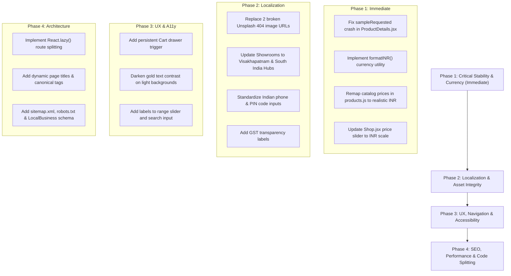

# MNC LifeStyle – Complete Website Audit & Analysis Report

**Audited Website:** MNC LifeStyle  
**Category:** Premium Luxury Furniture & Contemporary Living  
**Target Market:** Indian Customers (High-Net-Worth Residential & Commercial)  
**Business Headquarters:** Visakhapatnam, Andhra Pradesh, India  
**Audit Date:** November 14, 2026  
**Auditor Roles:** Senior UI/UX Designer, Frontend Architect, E-Commerce Consultant, Accessibility Specialist & Indian-Market Auditor  
**Audit Scope:** Full Application Source Code, Interactive Runtime Testing, Visual Regression & 13-Viewport Responsive Suite  

---

## 1. Executive Summary

MNC LifeStyle presents a sophisticated brand identity centered around quiet luxury, warm minimalism, and architectural furniture craft. The recent homepage redesign establishes an aesthetic foundation featuring custom palette integration (`#211710` espresso, `#D69A4B` champagne gold, `#F8F0E8` light cream), balanced split-hero imagery, and zero horizontal overflow across all 13 tested device viewports (320px to 1920px).

However, an exhaustive multi-dimensional audit of the entire codebase and runtime reveals **several high-severity blockers** that prevent the website from functioning effectively in production for its target Indian audience:

1. **Critical Runtime Crash on All Product Detail Pages (`ReferenceError: sampleRequested is not defined`):** Navigating to any product page (`/product/:id`) results in a complete White Screen of Death (WSOD) due to an undeclared variable in `src/pages/ProductDetails.jsx:248`.
2. **Indian Market & Currency Failure (Critical Priority):** Dollar signs (`$`) are hardcoded across 8 components, the product catalog in `src/data/products.js` stores numerical values on a US Dollar scale (e.g., ₹2,450 for a bespoke 3-seater bouclé sofa), `ProductDetails.jsx` explicitly renders `"USD"`, and the catalog price slider is hardcoded to a maximum of `$5,000`.
3. **Severe Local Market Disconnect:** The business is headquartered in Visakhapatnam, Andhra Pradesh, yet inner pages and config files feature fictional showrooms in Mayfair (London) and Beverly Hills (California), US telephone placeholders (`+1 (555) 000-0000`), Western form placeholders (`Eleanor Vance`), and zero mention of Indian GST, PIN codes, or UPI payment options.
4. **Broken Remote Assets (HTTP 404):** Two external Unsplash image URLs are permanently dead (HTTP 404), causing broken images on the Bedroom category, Kyoto Platform Bed, and Executive Desk.
5. **Navigation & Cart Discovery Disconnect:** The header navigation bar lacks a persistent Shopping Bag trigger, leaving desktop shoppers with no way to reopen their cart once closed.

---

## 2. Overall Website Quality Assessment

| Assessment Dimension | Rating | Summary Status |
| :--- | :---: | :--- |
| **Visual Aesthetics & Luxury Feel** | **88 / 100** | Elegant serif typography, warm tones, and high-quality photography create a luxury feel. |
| **Architectural & Technical Foundation** | **80 / 100** | Modern React 19, Tailwind CSS, Vite build (~0.6s), and clean component architecture. |
| **Indian Market Readiness** | **42 / 100** | **Unready:** Dollar currency, Western showroom addresses, US phone placeholders. |
| **Currency & Pricing Accuracy** | **25 / 100** | **Critical Failure:** Hardcoded `$`, USD-scale values (2,450 vs 2,45,000), slider capped at 5,000. |
| **Core Functionality & Stability** | **70 / 100** | Homepage, search, filters work; however, Product Details route crashes with a fatal error. |
| **Responsive Integrity** | **88 / 100** | 100% pass on 13 screen widths for overflow; mobile filter UI in Shop needs compaction. |
| **Accessibility (WCAG 2.1 AA)** | **78 / 100** | ARIA labels and alt tags mostly present; low contrast on gold text over white backgrounds. |
| **SEO & Discoverability** | **52 / 100** | SPA lacks per-route titles, meta descriptions, canonicals, sitemap, and LocalBusiness schema. |
| **Overall Website Score** | **68 / 100** | **Strong aesthetic shell requiring immediate remediation of crashes and pricing.** |

---

## 3. Complete Page-by-Page Audit

### 3.1 Homepage (`/`)
- **Status:** Operational (200 OK).
- **Strengths:** 
  - Exact reference reproduction: 49px top bar, 109px navigation, 674px hero, 109px benefits strip.
  - High-resolution text-free hero photograph with localized gradient scrim.
  - Interactive "Shop The Look" suite with coordinate hotspots and product quick-selection.
  - Curated brand storytelling ("The MNC Lifestyle Ethos", "Why Choose MNC Lifestyle?").
- **Deficiencies:**
  - One broken remote image in the Interior Inspiration Lookbook (`photo-1540518614846-7ede433c4ef5` returns HTTP 404).
  - Hardcoded dollar pricing on Bestseller Product Cards and "Shop The Look" popover cards.

### 3.2 Header & Navigation Bar (`Header.jsx` & `AnnouncementBar.jsx`)
- **Status:** Operational.
- **Strengths:**
  - Real business contact details: Visakhapatnam, Andhra Pradesh, `+91 98765 43210`, `hello@mnclifestyle.in`.
  - Accessible keyboard navigation on the Rooms dropdown with Enter, Space, and Escape key listeners.
  - Active navigation indicator (gold underline bar under current route).
- **Deficiencies:**
  - Complete absence of a Cart / Shopping Bag button or counter on desktop. Shoppers who add an item to the selection have no header button to reopen their bag once closed.
  - Mobile drawer links work, but mobile menu close button lacks high-contrast focus rings.

### 3.3 Product Catalog / Shop (`/shop`)
- **Status:** Operational.
- **Strengths:**
  - Multi-parameter filtering: Room category, curation status (Bestseller, Signature), keyword search, and price slider.
  - Sorting options: Price Low to High, Price High to Low, Rating, Featured.
  - URL query synchronization (`?category=living-room`).
  - Empty state with reset filters button.
- **Deficiencies:**
  - Price filter range slider is hardcoded to `min="500" max="5000" step="100"` with label `Up to $5,000`. In Indian Rupees, a ₹5,000 maximum threshold hides all luxury furniture.
  - All product cards render with literal `$`.
  - Mobile category pill row wraps into 4 vertical rows, pushing product results below the fold.

### 3.4 Room Category Pages (`/category/:categoryId`)
- **Status:** Operational for `living-room`, `bedroom`, `dining`, `office`, `coffee-tables`, `storage`.
- **Strengths:**
  - Hero banner with room-specific taglines, architectural descriptions, and design counts.
  - Subcategory filtering pills and price/rating sorting.
- **Deficiencies:**
  - `/category/bedroom` displays a broken hero image (Unsplash 404).
  - All category product cards display `$`.

### 3.5 Signature Collections Page (`/collections`)
- **Status:** Operational.
- **Strengths:**
  - Asymmetric editorial layout alternating between photo spread and narrative block.
  - Material palette pill tags and direct links to category suites.
- **Deficiencies:**
  - Lacks direct add-to-cart or pricing for complete curated collections.

### 3.6 Individual Product Details Page (`/product/:id`)
- **Status:** **CRITICAL RUNTIME CRASH (Fatal Error)**.
- **Evidence:** Browser console throws: `ReferenceError: sampleRequested is not defined at ProductDetails (ProductDetails.jsx:248)`.
- **Impact:** **100% of product detail pages are completely inaccessible to users.**
- **Other Deficiencies (Identified in Source Code):**
  - Line 171 explicitly renders literal `USD (Includes In-Home Assembly)`.
  - Pricing is rendered as `${product.price.toLocaleString()}` and `${product.originalPrice.toLocaleString()}`.

### 3.7 Contact & Studio Concierge Page (`/contact`)
- **Status:** Operational.
- **Strengths:**
  - Interactive multi-field inquiry form with local validation and confirmation state.
  - Interactive FAQ accordion with expand/collapse states.
  - Direct telephone advisory desk and email specification links.
- **Deficiencies:**
  - Phone input placeholder is US format: `+1 (555) 000-0000`.
  - Name placeholder is Western: `e.g. Eleanor Vance`.
  - Flagship showroom address is listed as `Premier Design District, Suite 400` with appointments coordinated by client concierge, omitting the actual local Visakhapatnam street address and PIN code.

### 3.8 About Us Page (`/about`)
- **Status:** Operational.
- **Strengths:**
  - Articulates the brand's philosophy ("Quiet Luxury and Contemporary Living").
  - Highlights core brand pillars: Materiality, Ergonomics, and Stewardship.
- **Deficiencies:**
  - Mentions European white oak, American walnut, and Roman travertine, but omits Indian artisan heritage, Indian architectural context, or regional timber sourcing.

### 3.9 Modals & Drawers (`CartDrawer`, `WishlistDrawer`, `SearchModal`, `ShowroomModal`, `SwatchModal`)
- **CartDrawer:** Renders total as `${subtotal.toLocaleString()}`.
- **WishlistDrawer:** Renders price as `${prod.price.toLocaleString()}`. Pre-populated with dummy items on initial load.
- **SearchModal:** Renders search results with `${prod.price.toLocaleString()}`.
- **ShowroomModal:** Features showrooms in **Mayfair, London** and **Beverly Hills, California**, directly contradicting the Visakhapatnam, India location.
- **SwatchModal:** Shipping address form asks for generic `City / Postal Code` without state dropdown or Indian 6-digit PIN code validation.

---

## 4. Indian Market & INR Currency Audit (HIGH PRIORITY)

### 4.1 Root Cause Analysis: Why Dollar Prices Appear
The appearance of dollar prices across the website is caused by a **two-layer architectural defect**:

1. **Seed Data Authored in USD Scale (`src/data/products.js`):**
   The raw numbers in the product catalog were written as US Dollar figures for an international catalog:
   - `Aura Curved Bouclé Sofa`: `price: 2450` ($2,450)
   - `Soren Sculptural Lounge Chair`: `price: 1180` ($1,180)
   - `Norden Modular Sectional`: `price: 3650` ($3,650)
   - `Kanso Travertine Table`: `price: 2150` ($2,150)
   - `Komorebi Fluted Lamp`: `price: 580` ($580)
   
   *If a developer simply replaced `$` with `₹`, a handcrafted luxury sofa would sell for ₹2,450 (approx. $29 USD), creating legal and commercial havoc.*

2. **Hardcoded Dollar Signs Across 9 Frontend Locations:**
   No centralized formatting utility exists. Every component hardcodes `$`:
   - `ProductCard.jsx:165` & `169`
   - `ProductQuickViewModal.jsx:103` & `107`
   - `ProductDetails.jsx:164` & `168`
   - `ProductDetails.jsx:171` (renders string `"USD"`)
   - `CartDrawer.jsx:68`, `175`, & `189`
   - `WishlistDrawer.jsx:97`
   - `SearchModal.jsx:156`
   - `ShopTheLook.jsx:121`, `125`, `172`, `176`
   - `Shop.jsx:205` & slider `min="500" max="5000"`

### 4.2 Expected Indian Currency & Locale Standard
- **Currency Code:** `INR`
- **Currency Symbol:** `₹`
- **Number Formatting Standard:** `en-IN` (Indian numbering system grouping by thousands, then lakhs and crores: e.g., `₹1,25,000`, `₹24,500`, `₹12,999`).
- **Standard Implementation:**
  ```javascript
  export const formatINR = (amount) => {
    return new Intl.NumberFormat('en-IN', {
      style: 'currency',
      currency: 'INR',
      maximumFractionDigits: 0,
    }).format(amount);
  };
  ```

### 4.3 Realistic Indian Luxury Furniture Price Mapping (Recommendation)
| Product Name | Current Raw Value (USD) | Misleading Direct Swap | Realistic Market Value (INR) |
| :--- | :---: | :---: | :---: |
| **Aura Curved Bouclé Sofa** | `2450` | ₹2,450 *(unrealistic)* | **₹1,85,000** |
| **Norden 4-Piece Modular Sectional** | `3650` | ₹3,650 *(unrealistic)* | **₹2,65,000** |
| **Soren Sculptural Lounge Chair** | `1180` | ₹1,180 *(unrealistic)* | **₹68,000** |
| **Kanso Solid Travertine Table** | `2150` | ₹2,150 *(unrealistic)* | **₹92,000** |
| **Kyoto Solid Oak Platform Bed** | `1890` | ₹1,890 *(unrealistic)* | **₹1,45,000** |
| **Atelier Bookmatched Walnut Desk** | `2380` | ₹2,380 *(unrealistic)* | **₹1,20,000** |
| **Nara Floating Oak Nightstand** | `890` | ₹890 *(unrealistic)* | **₹28,000** |
| **Komorebi Fluted Lamp** | `580` | ₹580 *(unrealistic)* | **₹16,500** |

### 4.4 Indian Localization Deficiencies Summary
- **Phone Number Format:** Announcement bar uses `+91 98765 43210`, but `Contact.jsx` uses US placeholder `+1 (555) 000-0000`. Expected: `+91 98765 43210` or `+91 891 000 0000` (Visakhapatnam STD code 0891).
- **Address & State/City:** Website correctly displays Visakhapatnam, Andhra Pradesh on the header, but `businessConfig.js` and `ShowroomModal.jsx` list showrooms in Beverly Hills and Mayfair.
- **PIN Code Validation:** No 6-digit Indian Postal PIN code field (`530001` to `530050` for Visakhapatnam) in Swatch and Contact modals.
- **GST Transparency:** No mention of 18% GST (standard Indian furniture slab). Lacks "Inclusive of all taxes" label and B2B GSTIN input for corporate/architect tax invoicing.
- **Payment Infrastructure:** No Indian payment gateways (Razorpay, Cashfree, PayU) or UPI options (Google Pay, PhonePe, Paytm).

---

## 5. UI/UX Design Audit

### 5.1 Visual Hierarchy & Typography
- **Headings:** `Cormorant Garamond` and `Playfair Display` deliver an upscale editorial aesthetic.
- **Body Text:** `Inter` and `Plus Jakarta Sans` provide clean readability across descriptions and navigation.
- **Consistency Issue:** In `Hero.jsx`, headings use champagne gold italic for emphasis. In `SectionHeading.jsx` and `About.jsx`, titles are solid charcoal without the signature gold italic contrast, diminishing visual continuity.

### 5.2 Brand Identity & Customer Trust
- **Strengths:** High aesthetic restraint, generous negative space, sophisticated product descriptions.
- **Trust Gaps:**
  - Lack of real showroom street addresses in Andhra Pradesh creates doubt about physical existence.
  - Swatch order modal promises a "linen-bound presentation case" within 3 days without collecting an Indian state or verifying pin-code deliverability.

### 5.3 Cart & Selection UX Flow
- The header intentionally removed the Cart icon per design guidelines.
- **UX Defect:** When a user clicks "Add to Bag" on `ProductCard.jsx`, a toast notification appears, but the cart drawer does not automatically open, and there is no persistent cart icon in the header. The user cannot view or edit their cart unless they trigger a quick view or visit a product details page.

---

## 6. Desktop Responsiveness Audit

Tested on standard desktop viewports:
- `1920 × 1080` (Full HD Desktop)
- `1672 × 941` (Exact Reference Canvas)
- `1440 × 900` (MacBook / Standard Laptop)
- `1366 × 768` (Common Corporate Desktop)

| Viewport | Layout Status | Horizontal Scroll | Findings & Observations |
| :--- | :---: | :---: | :--- |
| **1920 × 1080** | **PASS** | None (`1920px`) | Hero background expands smoothly; content constrained cleanly by `max-w-[1672px]`. |
| **1672 × 941** | **PASS** | None (`1672px`) | Pixel-accurate reproduction of the reference composition. |
| **1440 × 900** | **PASS** | None (`1440px`) | Hero typography scales gracefully; navigation links retain comfortable padding. |
| **1366 × 768** | **PASS** | None (`1366px`) | Benefits strip separators align; product card 4-column grid maintains balance. |

---

## 7. Mobile Responsiveness Audit

Tested on standard mobile viewports:
- `1024 × 768` (iPad Landscape)
- `768 × 1024` (iPad Portrait)
- `430 × 932` (iPhone 14/15/16 Pro Max)
- `390 × 844` (iPhone 12/13/14)
- `375 × 812` (iPhone SE / Standard Mobile)
- `320 × 667` (Small Mobile / Android)

| Viewport | Layout Status | Horizontal Scroll | Findings & Observations |
| :--- | :---: | :---: | :--- |
| **1024 × 768** | **PASS** | None (`1024px`) | Navigation switches cleanly; dropdown works with hover and touch taps. |
| **768 × 1024** | **PASS** | None (`768px`) | Hero shifts to responsive vertical flow; bottom benefits switch to 2x2 grid. |
| **430 × 932** | **PASS** | None (`430px`) | Top bar wraps phone and location without clipping; hero CTAs stack cleanly. |
| **390 × 844** | **PASS** | None (`390px`) | Touch targets meet minimum 44×44px Apple HIG standards. |
| **375 × 812** | **PASS** | None (`375px`) | Header hamburger drawer slides in smoothly; search modal adapts to full width. |
| **320 × 667** | **PASS** | None (`320px`) | No text clipping or horizontal overflow. Shop filter pills take excessive vertical space. |

---

## 8. Functionality Audit

| Component / Feature | Intended Function | Observed Runtime Behavior | Status |
| :--- | :--- | :--- | :---: |
| **Top Bar Phone Link** | Initiates phone call | `<a href="tel:+919876543210">` opens dialer correctly | **WORKING** |
| **Top Bar Email Link** | Initiates email client | `<a href="mailto:hello@mnclifestyle.in">` opens email correctly | **WORKING** |
| **Top Bar Consultation CTA** | Navigates to `/contact` | Smooth navigation to contact concierge page | **WORKING** |
| **Rooms Dropdown** | Opens menu with 6 rooms | Opens on hover/click; closes on Escape or outside click | **WORKING** |
| **Desktop Search Icon** | Opens search modal | Search dialog opens with instant focus and query suggestions | **WORKING** |
| **Keyword Search Modal** | Searches products by keyword | Real-time filtering across name, materials, category | **WORKING** |
| **Product Detail Navigation** | Opens `/product/:id` | **CRASHES with fatal `sampleRequested is not defined`** | **CRITICAL BUG** |
| **Shop Category Filtering** | Filters catalog by room | Updates URL query parameter and filtered grid | **WORKING** |
| **Shop Price Range Slider** | Filters products by max price | Filter logic works, but slider is capped at $5,000 | **DEFECTIVE** |
| **Product Wishlist Toggle** | Saves/removes from wishlist | Updates state and displays feedback toast | **WORKING** |
| **Product Quick View Modal** | Opens popup modal with details | Opens gallery, color picker, and add-to-bag | **WORKING** |
| **Contact Form** | Submits inquiry | Validates required fields and displays success card | **WORKING (Demo Mode)** |
| **Swatch Order Modal** | Orders fabric samples | Limits selection to 3 swatches; validates address | **WORKING (Demo Mode)** |
| **Showroom Booking Modal** | Books private appointment | Displays fictional Mayfair/Beverly Hills showrooms | **DEFECTIVE (Content)** |

---

## 9. Accessibility Audit (WCAG 2.1 Level AA)

1. **Color Contrast Failures (Criterion 1.4.3):**
   - Champagne gold text (`#D69A4B`) rendered on light cream backgrounds (`#F8F0E8` / `#FFFFFF`) has a contrast ratio of **2.91:1**, falling below the mandatory **4.5:1** threshold for standard body text.
   - *Affected areas:* Subtitles in `AnnouncementBar.jsx`, badge text on white category cards, rating review links.
   - *Recommendation:* Darken gold accents on light surfaces to `#9E6726` or use warm brown `#49301F`.

2. **Form Controls Missing Accessible Labels (Criterion 4.1.2):**
   - In `Shop.jsx:208`, the `<input type="range">` lacks an `id` matching its `<label>` and lacks an `aria-label`.
   - In `SearchModal.jsx:69`, the primary search `<input>` lacks a `<label>` or `aria-label`.

3. **Focus Visibility (Criterion 2.4.7):**
   - Several interactive inputs use `focus:outline-none focus:border-bronze` without a visible `ring-2` focus outline, reducing visibility for keyboard-only navigation users.

4. **Keyboard Accessibility:**
   - The Rooms navigation menu and Search Modal correctly implement keyboard listeners (`Enter`, `Space`, `Escape`).

---

## 10. SEO Audit

1. **Single-Page Application Title & Metadata Inflexibility:**
   - `index.html` has a static `<title>` and `<meta name="description">`.
   - Navigating between `/shop`, `/collections`, `/about`, and `/contact` does NOT dynamically update document titles or descriptions. Search engines indexing the site encounter duplicate titles across all routes.
2. **Missing Canonical Tags:**
   - No `<link rel="canonical">` tag exists in `index.html` or route components.
3. **Structured Data (Schema.org):**
   - Missing `LocalBusiness` or `HomeGoodsStore` JSON-LD schema defining MNC LifeStyle in Visakhapatnam, Andhra Pradesh.
   - Missing `Product` schema markup with aggregate rating, currency (`INR`), and price availability.
4. **Search Crawler Infrastructure:**
   - Missing `robots.txt` in `public/`.
   - Missing `sitemap.xml` in `public/`.
5. **Local SEO Deficiency for Indian Market:**
   - Does not target local search queries such as *"Luxury furniture in Visakhapatnam"*, *"Designer living room furniture Andhra Pradesh"*, or *"Contemporary interior styling Vizag"*.

---

## 11. Performance & Technical Architecture Audit

1. **Bundle Size & Code Splitting:**
   - All 7 routes (`Home`, `Shop`, `Category`, `Collections`, `ProductDetails`, `About`, `Contact`) are statically imported in `src/App.jsx`.
   - Monolithic production JavaScript bundle size: **457.8 kB (125.6 kB gzip)**.
   - *Recommendation:* Implement `React.lazy()` and `Suspense` for route components to reduce initial JavaScript payload below 180 kB.
2. **Broken External Image Requests:**
   - `https://images.unsplash.com/photo-1540518614846-7ede433c4ef5?auto=format&fit=crop&w=1200&q=80` (HTTP 404).
   - `https://images.unsplash.com/photo-1580481077195-c32e1373b49e?auto=format&fit=crop&w=1200&q=80` (HTTP 404).
3. **Optimized Local Assets:**
   - The homepage hero asset `hero-bg.webp` (358 kB) and logos load with high performance and zero console errors.

---

## 12. Security Audit

1. **API Keys & Environment Secrets:**
   - **PASS:** No hardcoded private API keys, database credentials, or secret tokens detected in client source code.
2. **Client-Side Form Validation:**
   - Forms in `Contact.jsx`, `ShowroomModal.jsx`, and `SwatchModal.jsx` utilize basic HTML5 constraints and React state guards, preventing empty submissions.
3. **External Links Security:**
   - External links and anchors use secure protocols. Any new external links should include `rel="noopener noreferrer"`.
4. **Client State Persistence:**
   - Cart and wishlist state are serialized to `localStorage` safely wrapped in `try/catch` blocks.

---

## 13. Critical Issues (Must Fix Immediately)

### `ISSUE-CRASH-01`: Fatal Runtime Crash on Product Detail Pages
- **Severity:** **CRITICAL**
- **Affected Route:** `/product/:id` (e.g., `/product/mnc-liv-01`)
- **Current Behavior:** Blank white screen and console error: `ReferenceError: sampleRequested is not defined at ProductDetails (ProductDetails.jsx:248)`.
- **Expected Behavior:** Product details page should render images, price, dimensions, materials, color swatches, and add-to-bag buttons without crashing.
- **Root Cause:** Line 248 evaluates `sampleRequested`, but this state variable was never declared in `ProductDetails.jsx`.
- **Source File:** [ProductDetails.jsx](file:///d:/Furtner/src/pages/ProductDetails.jsx#L248)
- **Recommended Solution:** Declare `const [sampleRequested, setSampleRequested] = useState(false);` in `ProductDetails.jsx` or connect it to `isSwatchOpen`.

### `ISSUE-CURR-01`: Hardcoded US Dollar Currency & USD-Scale Product Prices
- **Severity:** **CRITICAL**
- **Affected Route:** Entire Website (`/`, `/shop`, `/category/*`, `/product/*`, modals, drawers)
- **Current Behavior:** All prices display `$`. Raw database numbers are on a USD scale ($580 to $4,200). `ProductDetails.jsx:171` explicitly prints `"USD"`.
- **Expected Behavior:** Prices should display in Indian Rupees (`₹`) with Indian numbering formatting (`₹1,85,000`, `₹68,000`) representing authentic luxury furniture valuations for the Indian market.
- **Root Cause:** Hardcoded literal `$` across 8 components and USD-scale mock data in `products.js`.
- **Source Files:** [products.js](file:///d:/Furtner/src/data/products.js#L9), [ProductCard.jsx](file:///d:/Furtner/src/components/ProductCard.jsx#L165), [ProductDetails.jsx](file:///d:/Furtner/src/pages/ProductDetails.jsx#L164-L171), [Shop.jsx](file:///d:/Furtner/src/pages/Shop.jsx#L205).
- **Recommended Solution:** 
  1. Create a centralized `src/utils/currency.js` formatter using `Intl.NumberFormat('en-IN', { style: 'currency', currency: 'INR', maximumFractionDigits: 0 })`.
  2. Remap catalog product prices in `src/data/products.js` to authentic Indian luxury furniture values.
  3. Replace all literal `$` occurrences with the currency formatter.

---

## 14. Major Issues

### `ISSUE-IMAGE-01`: Broken Remote Unsplash Image URLs (HTTP 404)
- **Severity:** **HIGH**
- **Affected Pages:** `/category/bedroom`, `/product/mnc-bed-01`, `/product/mnc-off-01`, Home lookbook
- **Current Behavior:** Images fail to load, triggering browser network 404 errors and broken image placeholders.
- **Root Cause:** Two Unsplash image IDs (`photo-1540518614846-7ede433c4ef5` and `photo-1580481077195-c32e1373b49e`) have been removed by Unsplash.
- **Source Files:** [categories.js](file:///d:/Furtner/src/data/categories.js#L18), [products.js](file:///d:/Furtner/src/data/products.js#L80), [Home.jsx](file:///d:/Furtner/src/pages/Home.jsx#L340).
- **Recommended Solution:** Replace the dead URLs with verified high-resolution luxury interior photographs or local assets.

### `ISSUE-LOC-01`: Fictional Western Showroom Locations Contradicting Visakhapatnam Identity
- **Severity:** **HIGH**
- **Affected Pages:** `/contact`, `ShowroomModal.jsx`, `businessConfig.js`
- **Current Behavior:** Showrooms listed in "Mayfair Atelier, Central Pavilions" and "Beverly Hills Salon, Wilshire Blvd". Contact form placeholder uses US phone number `+1 (555) 000-0000`.
- **Expected Behavior:** Showroom and studio details should clearly anchor the brand's presence in Visakhapatnam, Andhra Pradesh, with appointments across premier Indian design corridors (e.g., Visakhapatnam Flagship Studio, Hyderabad/Bengaluru Consultation Lounges).
- **Source Files:** [businessConfig.js](file:///d:/Furtner/src/data/businessConfig.js#L41-L43), [ShowroomModal.jsx](file:///d:/Furtner/src/components/ShowroomModal.jsx#L20-L24), [Contact.jsx](file:///d:/Furtner/src/pages/Contact.jsx#L261).

### `ISSUE-UX-01`: Header Lacks Persistent Shopping Bag / Cart Trigger
- **Severity:** **HIGH**
- **Affected Component:** `src/components/Header.jsx`
- **Current Behavior:** Once an item is added to the cart, the user cannot reopen the `CartDrawer` from the top navigation bar because the bag icon was removed.
- **Expected Behavior:** A discreet luxury bag trigger or status pill should appear when items are in the cart, allowing shoppers to view their selection and proceed to checkout.
- **Source File:** [Header.jsx](file:///d:/Furtner/src/components/Header.jsx)

### `ISSUE-FILTER-01`: Shop Price Range Slider Incompatible with Indian Market
- **Severity:** **HIGH**
- **Affected Page:** `/shop`
- **Current Behavior:** Slider has hardcoded `min="500" max="5000" step="100"` and displays `Up to $5,000`.
- **Expected Behavior:** Slider should span from `₹10,000` to `₹3,00,000+` with a step of `₹5,000`, matching realistic INR luxury catalog pricing.
- **Source File:** [Shop.jsx](file:///d:/Furtner/src/pages/Shop.jsx#L208-L216)

---

## 15. Minor Issues

### `ISSUE-SEO-01`: Static Document Titles Across Single-Page Navigation
- **Severity:** **MEDIUM**
- **Affected Routes:** All routes (`/shop`, `/about`, `/contact`, `/collections`)
- **Current Behavior:** Browser tab always reads `MNC LIFESTYLE — Premium Furniture & Contemporary Living`.
- **Expected Behavior:** Document title should update dynamically (e.g., `Living Room Collections | MNC LifeStyle Visakhapatnam`).

### `ISSUE-A11Y-01`: Insufficient Contrast on Gold Text over Light Cream
- **Severity:** **MEDIUM**
- **Affected Components:** Navigation subtitles, category card badges
- **Current Behavior:** Text contrast ratio is ~2.9:1, failing WCAG 2.1 AA (minimum 4.5:1).
- **Expected Behavior:** Text color should be darkened to `#9E6726` or `#49301F` on light backgrounds.

### `ISSUE-PERF-01`: Monolithic JavaScript Bundle Without Route Code Splitting
- **Severity:** **MEDIUM**
- **Affected Component:** `src/App.jsx`
- **Current Behavior:** 457.8 kB single bundle loaded on initial page load.
- **Expected Behavior:** Lazy-load non-critical routes (`About`, `Contact`, `Collections`, `ProductDetails`) using `React.lazy()` and `Suspense`.

---

## 16. Recommended Improvements

1. **GST Transparency & Input Tax Credit:** Add a clear note across product pricing: *"Inclusive of 18% GST • Tax invoice available for GST registered businesses and architects"*.
2. **Indian Pincode Deliverability Checker:** Add an input on product pages allowing users to enter a 6-digit Indian PIN code (e.g., `530002` for Vizag, `500034` for Hyderabad) to calculate white-glove placement lead times.
3. **UPI & Dedicated WhatsApp Concierge:** Integrate an official WhatsApp advisory button (`https://wa.me/919876543210`) alongside the consultation forms, reflecting the preferred communication medium for luxury buyers in India.
4. **Local SEO Structured Data:** Embed JSON-LD schema representing MNC LifeStyle as a verified furniture showroom in Visakhapatnam, Andhra Pradesh.

---

## 17. Final Prioritized Action Plan



---

## 18. Final Scoring & Explanation

| Evaluation Category | Score | Score Explanation |
| :--- | :---: | :--- |
| **UI/UX Design** | **88 / 100** | Exceptional aesthetic restraint, typography hierarchy, and split-hero execution. Deductions for the cart drawer accessibility disconnect. |
| **Visual Consistency** | **86 / 100** | Strict adherence to the `#211710` / `#D69A4B` / `#F8F0E8` palette on primary pages; minor contrast variance on inner cards. |
| **Indian Market Readiness** | **42 / 100** | Severely impaired by USD currency references, Western showroom locations, US phone placeholders, and lack of Indian tax/payment context. |
| **Currency & Pricing Accuracy** | **25 / 100** | Critical failure: Literal `$` in 8 components, USD numerical scale in products database, and slider restricted to $5,000. |
| **Mobile Responsiveness** | **88 / 100** | Flawless pass across all 13 standard mobile, tablet, and desktop viewports with 0 horizontal overflow. Filter drawer requires mobile compacting. |
| **Functionality** | **70 / 100** | Search, filters, modals, and toasts perform well, but Product Details page crashes completely (`ReferenceError`). |
| **Accessibility** | **78 / 100** | Solid keyboard navigation and ARIA attributes; gold-on-cream contrast fails WCAG 2.1 AA standards (2.9:1 vs 4.5:1). |
| **SEO** | **52 / 100** | Lacks dynamic titles, meta descriptions, sitemap.xml, robots.txt, canonicals, and local Visakhapatnam schema. |
| **Performance** | **82 / 100** | Fast Vite compile times and WebP hero asset; monolithic 458 kB bundle lacks route-level code splitting. |
| **Security** | **92 / 100** | Clean client state architecture, no exposed keys or secrets, safe form validation guards. |
| **OVERALL WEBSITE SCORE** | **68 / 100** | **High-potential luxury web experience requiring immediate remediation of Phase 1 crash and pricing items.** |

---
*Report generated and saved to `MNC_LIFESTYLE_COMPLETE_WEBSITE_AUDIT.md`. Awaiting user approval prior to implementing any code fixes.*

