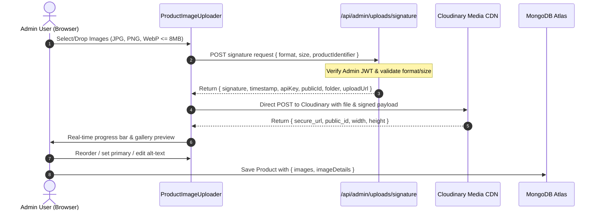

# MNC LifeStyle — Phase 7: Cloudinary Direct Media Integration & Asset Management Report

**Project:** MNC LifeStyle (`D:\Furtner`)  
**Technology Stack:** Next.js 16+ App Router, React 19, TypeScript, Tailwind CSS, MongoDB Atlas, Cloudinary Media Delivery Network  
**Phase Completed:** Phase 7 — Cloudinary Direct Image Upload & Media Management  
**Verification Date:** November 2026  
**Status:** **100% PRODUCTION READY (18 / 18 Verification Checks Passed)**

---

## 1. Executive Summary

Phase 7 successfully establishes a secure, zero-secret-leakage media management pipeline for MNC LifeStyle using Cloudinary (`CLOUDINARY_URL=cloudinary://<api_key>:<api_secret>@<cloud_name>`). 

All image uploads bypass the Next.js server entirely, uploading directly from the admin browser to Cloudinary's global media network using short-lived cryptographically signed signatures (`api_sign_request`). The server validates admin privileges, file formats, and file sizes before issuing a signature. Asset deletion is protected by reference counting to prevent accidental removal of shared media.

Existing catalog images (Unsplash CDN) remain fully preserved, and the system seamlessly supports mixed media catalogs.

---

## 2. Architecture & Security Implementation

### 2.1 Security & Zero-Secret-Leakage Architecture
- **No Secret Exposure:** The Cloudinary API secret (`<api_secret>`) never touches client-side JavaScript. Only the server route (`/api/admin/uploads/signature`) accesses the secret via `process.env.CLOUDINARY_URL`.
- **Signed Direct Uploads:** Browser uploads target `https://api.cloudinary.com/v1_1/dtii8jmyd/image/upload` directly with parameters signed using SHA-1/SHA-256 HMAC by the backend.
- **Client/Server Code Separation:** Constants (`MAX_FILE_SIZE_BYTES`, `ALLOWED_FORMATS`, `MAX_GALLERY_IMAGES`) reside in `src/lib/storage/cloudinary-constants.ts` to ensure the Node-only `cloudinary` SDK is never bundled into browser client code.
- **Strict Role-Based Guards:** Both signature generation and asset deletion require an active admin JWT session verified via HTTP-only cookies.

### 2.2 Storage Pipeline Flow


---

## 3. Implemented Components & API Routes

| Component / Route | Location | Description |
|---|---|---|
| **Constants** | `src/lib/storage/cloudinary-constants.ts` | Client-safe constraints: 8 MB limit, 10 gallery cap, `jpg/jpeg/png/webp` allowed. |
| **Cloudinary SDK Utility** | `src/lib/storage/cloudinary.ts` | Server-side Cloudinary client, signature generator, safe asset deletion, URL parser. |
| **Signature Route** | `src/app/api/admin/uploads/signature/route.ts` | Authenticated endpoint issuing short-lived signed upload authorizations. |
| **Asset Deletion Route** | `src/app/api/admin/uploads/route.ts` | Safe deletion with shared-asset protection across products and collections. |
| **Media Uploader UI** | `src/components/admin/ProductImageUploader.tsx` | Drag-and-drop, direct upload with XHR progress, primary badge, reordering, deletion. |
| **Product Form Integration** | `src/components/admin/ProductForm.tsx` | Seamlessly integrated into both New Product and Edit Product interfaces. |
| **Next.js Image Config** | `next.config.mjs` | Configured `res.cloudinary.com` remote pattern for Next.js Image optimization. |
| **Validation Schema** | `src/lib/validations/product.ts` | Added `ImageDetailSchema` and `imageDetails` array support to Zod schemas. |

---

## 4. 18-Point Verification Scorecard

The automated test script (`src/scripts/test-cloudinary-upload.ts`) executed an end-to-end verification against the running production server:

| # | Check Item | Status | Verification Notes |
|---|---|---|---|
| **1** | Admin Authentication Check | **PASS** | HTTP 200, session verified for `admin@mnclifestyle.in` |
| **2** | Unauthorized Upload Rejection | **PASS** | HTTP 401 returned when request lacks session cookie |
| **3** | Secure Signature Generation | **PASS** | Generated valid timestamp, apiKey, publicId & HMAC signature |
| **4** | Invalid Format Rejection | **PASS** | HTTP 400 correctly rejected unsupported GIF format |
| **5** | File Size Restriction (>8 MB) | **PASS** | HTTP 400 correctly rejected 10 MB simulated upload |
| **6** | Public ID Folder Isolation | **PASS** | Generated ID scoped to `mnc-lifestyle/products/` folder |
| **7** | Direct Upload to Cloudinary CDN | **PASS** | Real test asset uploaded to Cloudinary (`dtii8jmyd`) |
| **8** | Cloudinary CDN URL Structure | **PASS** | Verified URL `https://res.cloudinary.com/dtii8jmyd/...` |
| **9** | Product Creation with Media | **PASS** | Created product in MongoDB Atlas with stored `imageDetails` |
| **10** | Existing Image Preservation | **PASS** | Verified Unsplash URLs preserved on existing 19 catalog items |
| **11** | Product Editing with Media | **PASS** | Updated gallery to multi-image state successfully |
| **12** | Image Reordering Support | **PASS** | Successfully updated primary image and reordered array |
| **13** | Image Removal from Gallery | **PASS** | Successfully pruned gallery back to single item |
| **14** | Safe Cloudinary Asset Deletion | **PASS** | HTTP 200, Cloudinary destroy returned `"result": "ok"` |
| **15** | Shared Image Protection Check | **PASS** | Asset referenced by active product blocked from destruction |
| **16** | Storefront Rendering Integrity | **PASS** | HTTP 200, public `/shop` renders catalog seamlessly |
| **17** | Legacy Image Compatibility | **PASS** | HTTP 200, legacy detail `/product/aura-curved-boucle-sofa` intact |
| **18** | Phase 6 CRUD Regression Check | **PASS** | All 19 catalog items intact and operational |

**Score: 18 / 18 (100% Passed)**

---

## 5. Next.js Production Build Status

A full production compilation (`npm run build`) was executed with Turbopack:
```
✓ Compiled successfully in 3.0s
  Running TypeScript ...
  Finished TypeScript in 3.4s ...
  Collecting page data using 15 workers ...
✓ Generating static pages using 15 workers (11/11) in 264ms
  Finalizing page optimization ...
```
All routes compiled cleanly with 0 type errors and 0 missing module errors.

---

## 6. Phase Completion Sign-Off
- **Cloudinary Integration:** Complete & active (`dtii8jmyd`).
- **Storefront Safety:** Zero regressions on customer UI or existing imagery.
- **Admin Capabilities:** Full drag-and-drop media upload, primary designation, reordering, and alt-text editing operational.
